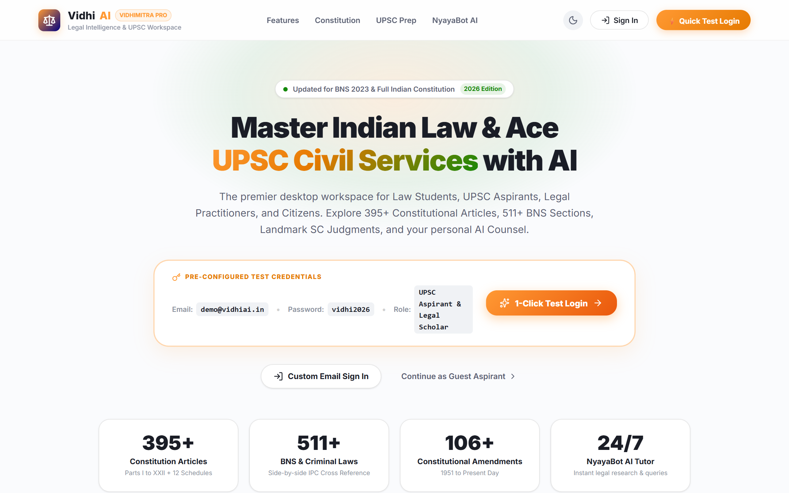
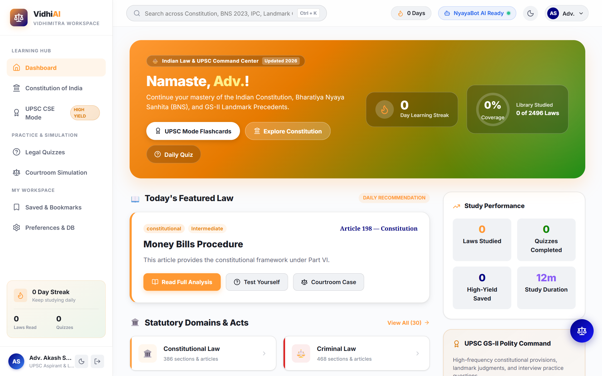
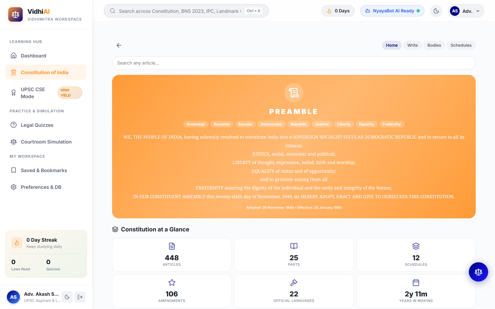
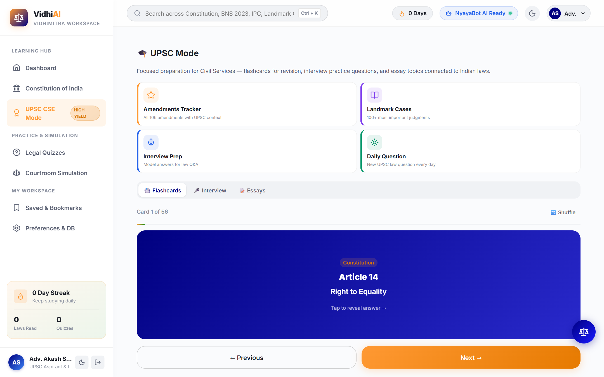

<div align="center">

# ⚖️ VidhiAI (VidhiMitra)
### *Next-Generation Indian Legal Intelligence & UPSC Civil Services Desktop Workspace*

[](https://react.dev/)
[](https://vite.dev/)
[](https://nodejs.org/)
[](https://fusejs.io/)
[](https://www.mha.gov.in/)
[](https://upsc.gov.in/)
[](LICENSE)

<p align="center">
  <strong>VidhiAI</strong> (VidhiMitra) is a comprehensive, desktop-first legal intelligence platform built for Law Students, Judicial Services (PCS-J) Aspirants, UPSC Civil Services (GS-II) Candidates, Legal Practitioners, and Citizens.
</p>

[Live Screenshots](#-live-application-showcase) • [Test Login](#-pre-configured-test-login) • [Key Features](#-core-capabilities) • [Getting Started](#-getting-started) • [Architecture](#-database--system-architecture)

</div>

---

## 📸 Live Application Showcase

*Actual high-resolution screenshots captured directly from the live running application (`http://localhost:5173/`).*

### 1. Modern SaaS Landing Page with 1-Click Test Login
High-impact hero section with Indian Tricolor ambient lighting, pre-configured test credentials callout, feature matrix, and one-click authentication.

<div align="center">
  
</div>

<br />

### 2. Full-Width Desktop Workspace & Dashboard
Expansive horizontal layout featuring a 270px pinned sidebar, top navigation with global fuzzy search (`Ctrl + K`), streak counter, Today's Featured Law spotlight, and multi-column statutory domain cards.

<div align="center">
  
</div>

<br />

### 3. Constitution of India Command Center
Browse all 22 Parts, 395 Articles, Schedules 1–12, Constitutional Writs, and Bodies with simplified summaries, legal text, and case precedents.

<div align="center">
  
</div>

<br />

### 4. UPSC GS-II Civil Services Prep Hub
Spaced-repetition flashcards, landmark Supreme Court judgments, 1st to 106th Constitutional Amendments, and Mains interview drills.

<div align="center">
  
</div>

---

## 🔑 Pre-Configured Test Login

VidhiAI comes with pre-configured demo credentials right on the landing page:

| Parameter | Demo Credential | Description |
| :--- | :--- | :--- |
| **Email** | `demo@vidhiai.in` | Pre-configured test account |
| **Password** | `vidhi2026` | Default demo password |
| **User Role** | **Adv. Akash Sharma** | UPSC Aspirant & Legal Scholar |
| **Target Exam** | *UPSC CSE 2026 / PCS-J* | Pre-configured curriculum |
| **⚡ Instant Access** | **1-Click Test Login** | Click the orange button on the landing page to enter immediately |

*(Legacy credentials `demo@kanoonsikho.in` / `kanoon2026` remain backwards-compatible).*

---

## 🌟 Core Capabilities

### 🏛️ 1. Complete Indian Constitution Suite
* **All 22 Parts & 395 Articles**: Exhaustive coverage from Fundamental Rights (Part III) to Directive Principles (Part IV), Union Executive (Part V), and Emergency Provisions (Part XVIII).
* **5 Constitutional Writs**: Practical grounds, locus standi, and judicial remedies for *Habeas Corpus*, *Mandamus*, *Certiorari*, *Prohibition*, and *Quo Warranto*.
* **12 Schedules & Constitutional Bodies**: Ready-reference notes on Election Commission, CAG, Finance Commission, and UPSC.

### ⚖️ 2. Bharatiya Nyaya Sanhita (BNS 2023) Transition
* **IPC ➔ BNS Cross-Mapping**: Direct cross-referencing between old Indian Penal Code sections and modern Bharatiya Nyaya Sanhita laws.
* **Offence Classifications**: Instant badges indicating Bailable vs. Non-Bailable, Cognizable vs. Non-Cognizable, and maximum prescribed sentences.
* **Procedural Codes**: Includes Bharatiya Nagarik Suraksha Sanhita (BNSS) and Bharatiya Sakshya Adhiniyam (BSA).

### 🎓 3. UPSC GS-II & Judicial Services Engine
* **Landmark Supreme Court Judgments**: In-depth analytical ratios of *Kesavananda Bharati*, *Maneka Gandhi*, *K.S. Puttaswamy*, *Minerva Mills*, and *S.R. Bommai*.
* **1st to 106th Amendments**: Chronological digest detailing the historical context, parliamentary voting, and constitutional significance of every amendment.
* **Mains Essays & Interview Q&A**: Model answers to questions on judicial review, Uniform Civil Code (UCC), cooperative federalism, and digital privacy.

### 🤖 4. NyayaBot AI Legal Counsel
* **Natural Language Queries**: Ask situational legal questions in conversational language (e.g., *"My landlord is withholding my security deposit"* or *"What are the loopholes in UAPA?"*).
* **Speech-to-Text Recognition**: Hands-free voice querying powered by the Web Speech API.
* **Statutory Citations**: Generates clear, structured answers with relevant section numbers, judicial precedents, and practical court strategies.

### 🏛️ 5. Interactive Courtroom Simulator
* **Real-World Case Scenarios**: Roleplay as the prosecutor or defense counsel across realistic criminal, civil, and constitutional litigation.
* **Judicial Verdicts**: Test your evidentiary arguments against statutory provisions to evaluate judicial outcomes.

### 📊 6. Gamified Study Metrics
* **Study Streaks**: Daily flame counter and coverage percentage rings to maintain study discipline.
* **High-Yield Bookmarking**: Save tricky sections and landmark cases for quick revision.
* **Chapter Quizzes**: Interactive multiple-choice assessments with immediate explanations.

---

## 🏗️ Database & System Architecture

VidhiAI operates on an **Embedded Document-Store / In-Memory Database** architecture:

```
┌─────────────────────────────────────────────────────────────────┐
│                    Vite + React 19 Frontend                     │
│  ┌───────────────────────────┐    ┌──────────────────────────┐  │
│  │   Desktop App Canvas      │    │     Fuse.js Engine       │  │
│  │ (Sidebar + Top Bar + Grid)│    │ (In-Memory Fuzzy Search) │  │
│  └─────────────┬─────────────┘    └────────────▲─────────────┘  │
│                │                               │                │
│                ▼                               │                │
│       localStorage State               src/data/laws.json       │
│  (Auth, Streak, Bookmarks)                (4.43 MB DB)          │
└────────────────────────────────────────────────┼────────────────┘
                                                 │
                                      ┌──────────▼────────────┐
                                      │  Express API Server   │
                                      │       (Port 3001)     │
                                      │  - /api/seed          │
                                      │  - /api/bot/chat      │
                                      └───────────────────────┘
```

* **Zero External DB Overhead**: Runs immediately without requiring PostgreSQL, MySQL, or MongoDB services.
* **Instant Client-Side Lookups**: Complete offline-capable search across 1,000+ statutes with sub-millisecond fuzzy matching via **Fuse.js**.
* **State Persistence**: User progress, reading history, and quiz scores are stored locally in the browser's `localStorage`.

---

## 🚀 Getting Started

### Prerequisites
* **Node.js**: v18.0.0 or higher
* **npm**: v9.0.0 or higher

### Installation

1. **Clone the repository**:
   ```bash
   git clone https://github.com/akashnarayanan007/VidhiAI.git
   cd VidhiAI
   ```

2. **Install frontend dependencies**:
   ```bash
   npm install
   ```

3. **Install backend dependencies**:
   ```bash
   cd server
   npm install
   cd ..
   ```

---

## 💻 Running the Application

### Option 1: Run Full Workspace (Single Command)

```bash
npm run dev:all
```
*Starts the Express API server on `http://localhost:3001` and launches the Vite React frontend on `http://localhost:5173`.*

---

### Option 2: Run in Separate Terminals

**Terminal 1 — Backend API Server:**
```bash
npm run server
```

**Terminal 2 — Frontend Desktop App:**
```bash
npm run dev
```

Open **`http://localhost:5173`** in your browser to view the live **VidhiAI Landing Page**!

---

## 📂 Project Directory Structure

```text
VidhiAI/
├── docs/
│   └── screenshots/               # Actual live application screenshots
│       ├── landing-preview.png    # Modern landing page with 1-click test login
│       ├── dashboard-preview.png  # Desktop workspace & command center
│       ├── constitution-preview.png# Constitution of India 22 Parts & Articles
│       └── upsc-preview.png       # UPSC GS-II Flashcards & Prep Hub
├── public/                        # Static assets & icons
├── scripts/
│   ├── captureScreenshots.mjs     # Automated screenshot capture utility
│   └── seedAllLaws.js             # Data generation script
├── server/                        # Express API Backend (Port 3001)
│   ├── routes/
│   │   └── seed.js                # Database seeding endpoints
│   ├── package.json               # Backend dependencies (express, cors)
│   └── server.js                  # NyayaBot AI chat endpoint & fallback engine
├── src/                           # Frontend React Application
│   ├── components/
│   │   ├── DesktopHeader.jsx      # Global search, streak chip & user menu
│   │   ├── DesktopSidebar.jsx     # Pinned 270px desktop navigation sidebar
│   │   └── NyayaBot.jsx           # Voice-enabled AI counsel assistant
│   ├── data/
│   │   ├── laws.json              # 4.43 MB embedded database (1000+ entries)
│   │   ├── upscCasesData.js       # Landmark Supreme Court judgments
│   │   ├── upscAmendmentsData.js  # 1st to 106th Amendments
│   │   └── upscInterviewQA.js     # UPSC Mains & Interview model Q&A
│   ├── screens/
│   │   ├── LandingPage.jsx        # SaaS Landing page with 1-Click Login
│   │   ├── HomeScreen.jsx         # Desktop Command Center & Dashboard
│   │   ├── ConstitutionHome.jsx   # 22 Parts, Articles, and Writs
│   │   ├── UPSCModeScreen.jsx     # UPSC GS-II Flashcards & Prep Hub
│   │   ├── LawDetailScreen.jsx    # Statutory reading & analysis
│   │   ├── QuizScreen.jsx         # Legal knowledge testing
│   │   ├── CourtScenarioScreen.jsx# Interactive courtroom simulation
│   │   ├── BookmarksScreen.jsx    # High-yield saved laws
│   │   └── SettingsScreen.jsx     # User profile, theme toggle & DB status
│   ├── services/
│   │   ├── authService.js         # Authentication, demo login & user state
│   │   ├── lawService.js          # Fuse.js search & category statistics
│   │   └── progressService.js     # Streaks, quiz scoring & local storage
│   ├── App.jsx                    # Root desktop router & authentication guard
│   ├── index.css                  # Comprehensive design system & responsive styling
│   └── main.jsx                   # Application entry point
├── package.json                   # Root scripts & dependencies
├── vite.config.js                 # Vite configuration with proxy to backend
└── README.md                      # Project documentation
```

---

## 🧰 Tech Stack

| Domain | Technologies |
| :--- | :--- |
| **Frontend Framework** | React 19, React Router v7, Vite 8 |
| **UI & Styling** | Pure CSS3 Design System, Framer Motion, Lucide React Icons |
| **Search Engine** | Fuse.js (Client-Side In-Memory Fuzzy Search) |
| **Backend API** | Node.js, Express 4, CORS |
| **Database** | Embedded JSON Document Store (`laws.json`), Browser `localStorage` |
| **AI Capabilities** | Anthropic Claude API / Smart statutory heuristic fallback |
| **Voice Processing**| Web Speech API (SpeechRecognition & SpeechSynthesis) |

---

## 📋 Legal Disclaimer

> [!IMPORTANT]
> **VidhiAI (VidhiMitra)** is an educational, academic, and competitive examination preparation workspace. It does **not** provide formal legal counsel or create an attorney-client relationship. For real-world legal proceedings, consult an advocate enrolled with the Bar Council of India.

---

## 📄 License

This project is licensed under the [MIT License](LICENSE).

<div align="center">
  <sub>Dedicated to expanding legal literacy, democratic values, and civil services excellence across India. 🇮🇳</sub>
</div>
