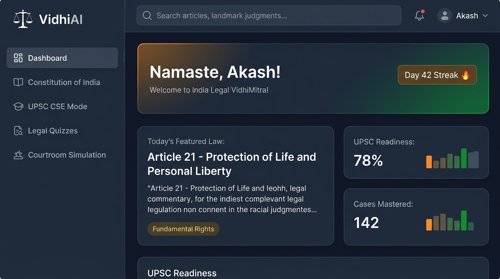
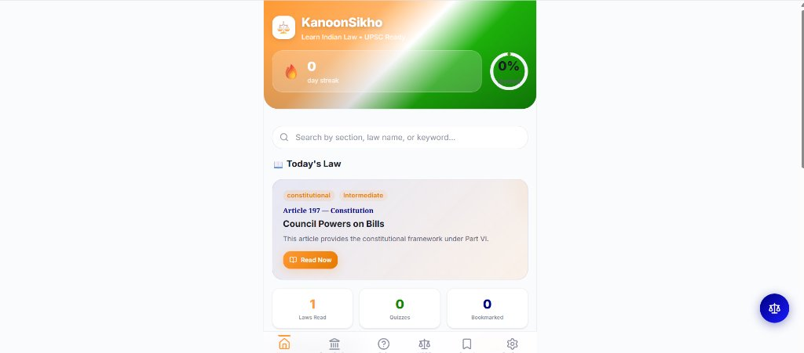

<div align="center">

# ⚖️ VidhiAI (VidhiMitra)
### *Indian Legal Intelligence & UPSC Civil Services Command Center*

[](https://react.dev/)
[](https://vite.dev/)
[](https://nodejs.org/)
[](https://fusejs.io/)
[](https://www.mha.gov.in/)
[](https://upsc.gov.in/)
[](LICENSE)

<p align="center">
  <strong>VidhiAI</strong> (also known as <strong>VidhiMitra</strong>) is a modern, responsive legal workspace engineered for law students, judicial aspirants (PCS-J), UPSC Civil Services candidates, advocates, and informed citizens.
</p>

[Explore Features](#-key-features) • [Screenshots](#-screenshots) • [Test Login](#-test-login-credentials) • [Getting Started](#-getting-started) • [Architecture](#-database--architecture)

</div>

---

## 📸 Screenshots

### 1. Modern Desktop Dashboard Workspace
An expansive desktop experience featuring a 270px pinned navigation sidebar, India Tricolor ambient hero banner, daily study streak tracker, Today's Featured Law spotlight, and UPSC readiness metrics.

<div align="center">
  
</div>

<br />

### 2. Statutory Card & Revision Interface
Detailed statutory breakdowns complete with real-world examples, legal loopholes, landmark Supreme Court precedents, and interactive flashcard revision.

<div align="center">
  
</div>

---

## 🔑 Test Login Credentials

VidhiAI comes with pre-configured demo credentials. You can enter directly with the **"⚡ 1-Click Test Login"** button on the landing page or type:

| Field | Demo Credential | Description |
| :--- | :--- | :--- |
| **Email** | `demo@vidhiai.in` | Pre-configured test account |
| **Password** | `vidhi2026` | Default demo password |
| **User Role** | **Adv. Akash Sharma** | UPSC Aspirant & Legal Scholar |
| **Quick Action** | *1-Click Enter* | Auto-fills and bypasses manual input |

*(Legacy credentials `demo@kanoonsikho.in` / `kanoon2026` remain backwards-compatible).*

---

## 🌟 Key Features

### 🏛️ 1. Complete Constitution of India
* **All 22 Parts & 395 Articles**: From Fundamental Rights (Part III) to Directive Principles (Part IV) and Emergency Provisions (Part XVIII).
* **Constitutional Writs**: In-depth analysis of *Habeas Corpus*, *Mandamus*, *Certiorari*, *Prohibition*, and *Quo Warranto*.
* **12 Schedules & Constitutional Bodies**: Detailed notes on CAG, Election Commission, Finance Commission, and UPSC.

### ⚖️ 2. Bharatiya Nyaya Sanhita (BNS 2023) Transition
* **IPC 1860 ➔ BNS 2023 Mapping**: Direct side-by-side section cross-references.
* **Classification**: Instant tags for Bailable vs. Non-Bailable, Cognizable vs. Non-Cognizable offences, and prescribed punishments.
* **Procedural Codes**: Coverage across Bharatiya Nagarik Suraksha Sanhita (BNSS) and Bharatiya Sakshya Adhiniyam (BSA).

### 🎓 3. UPSC GS-II Polity Command Center
* **Landmark SC Judgments**: Analytical summaries of *Kesavananda Bharati*, *Maneka Gandhi*, *K.S. Puttaswamy*, *Minerva Mills*, and *S.R. Bommai*.
* **1st to 106th Amendments**: Chronological digest detailing the historical context and exam significance of every amendment.
* **Mains Essays & Interview Q&A**: Model answers to high-yield questions on judicial review, UCC, federalism, and digital privacy.

### 🤖 4. NyayaBot AI Legal Assistant
* **Natural Language Queries**: Ask questions in plain English or Hinglish (e.g., *"My landlord won't return my deposit"* or *"Explain Article 21 with case laws"*).
* **Voice-Enabled Dictation**: Native speech recognition for hands-free querying.
* **Statutory Grounding**: References exact section numbers, precedents, and legal strategies.

### 🏛️ 5. Interactive Courtroom Simulation
* **Litigation Practice**: Step into realistic courtroom scenarios as prosecutor or defense counsel.
* **Judicial Verdicts**: Evaluate legal arguments against real statutory provisions to sharpen forensic reasoning.

### 📊 6. Gamified Progress Tracking
* **Daily Streaks**: Build daily study discipline with flame counters.
* **Smart Flashcards**: Spaced repetition for rapid revision before exams.
* **Topic Quizzes**: Chapter-wise knowledge assessments with immediate score breakdowns.

---

## 🛠️ Database & Architecture

VidhiAI uses an **Embedded Flat-File / Document-Store Database** architecture:

```
┌────────────────────────────────────────────────────────┐
│                   Vite + React 19 Frontend             │
│  ┌──────────────────────┐    ┌──────────────────────┐  │
│  │   Desktop Layout     │    │     Fuse.js Engine   │  │
│  │ (Sidebar + Top Bar)  │    │  (In-Memory Fuzzy)   │  │
│  └──────────┬───────────┘    └──────────▲───────────┘  │
│             │                           │              │
│             ▼                           │              │
│     localStorage State            src/data/laws.json   │
│ (Streak, Progress, Auth)             (4.43 MB DB)      │
└─────────────────────────────────────────┼──────────────┘
                                          │
                               ┌──────────▼───────────┐
                               │  Express API Server  │
                               │     (Port 3001)      │
                               │  - /api/seed         │
                               │  - /api/bot/chat     │
                               └──────────────────────┘
```

* **Zero External DB Dependencies**: No MongoDB, PostgreSQL, or Docker setup required.
* **Sub-Millisecond Search**: Indexed client-side with **Fuse.js** for zero-latency fuzzy lookups.
* **Persistent Progress**: Reading records, bookmarks, and quiz scores persist in browser `localStorage`.

---

## 🚀 Getting Started

### Prerequisites
* **Node.js**: v18.0.0 or higher
* **npm**: v9.0.0 or higher

### Installation

1. **Clone the repository**:
   ```bash
   git clone https://github.com/your-username/vidhi-ai.git
   cd vidhi-ai
   ```

2. **Install frontend dependencies**:
   ```bash
   npm install
   ```

3. **Install backend dependencies**:
   ```bash
   cd server
   npm install
   cd ..
   ```

---

## 💻 Running the Application

### Option 1: Run Both Concurrently (Recommended)

From the project root:
```bash
npm run dev:all
```
*Starts the Express API server on `http://localhost:3001` and the Vite React frontend on `http://localhost:5173`.*

---

### Option 2: Run in Separate Terminals

**Terminal 1 — Backend API Server:**
```bash
npm run server
```

**Terminal 2 — Frontend Desktop App:**
```bash
npm run dev
```

Open **`http://localhost:5173`** in your browser. You will be greeted by the **VidhiAI Landing Page**!

---

## 📂 Project Directory Structure

```text
Better Call Saul/
├── docs/
│   └── screenshots/               # Application preview screenshots
│       ├── desktop-dashboard.png  # Desktop workspace UI mockup
│       └── app-preview.jpg        # Statutory card preview
├── public/                        # Static icons and SVGs
├── server/                        # Express API Backend
│   ├── routes/
│   │   └── seed.js                # Database seeding endpoints
│   ├── package.json               # Backend dependencies (express, cors)
│   └── server.js                  # NyayaBot AI chat endpoint & fallback logic
├── src/                           # Frontend React Application
│   ├── components/
│   │   ├── DesktopHeader.jsx      # Top search bar, streak pill & user menu
│   │   ├── DesktopSidebar.jsx     # Pinned 270px desktop navigation
│   │   └── NyayaBot.jsx           # Floating AI counsel widget
│   ├── data/
│   │   ├── laws.json              # 4.43 MB embedded database (1000+ entries)
│   │   ├── upscCasesData.js       # Landmark Supreme Court judgments
│   │   ├── upscAmendmentsData.js  # 1st to 106th Amendments
│   │   └── upscInterviewQA.js     # UPSC Mains & Interview model Q&A
│   ├── screens/
│   │   ├── LandingPage.jsx        # SaaS Landing page with 1-Click Login
│   │   ├── HomeScreen.jsx         # Desktop Command Center & Dashboard
│   │   ├── ConstitutionHome.jsx   # 22 Parts, Articles, and Writs
│   │   ├── UPSCModeScreen.jsx     # UPSC GS-II Flashcards & Prep Hub
│   │   ├── LawDetailScreen.jsx    # Statutory reading & analysis
│   │   ├── QuizScreen.jsx         # Legal knowledge testing
│   │   ├── CourtScenarioScreen.jsx# Interactive courtroom simulation
│   │   ├── BookmarksScreen.jsx    # High-yield saved laws
│   │   └── SettingsScreen.jsx     # User profile, theme toggle & DB status
│   ├── services/
│   │   ├── authService.js         # Authentication, demo login & user state
│   │   ├── lawService.js          # Fuse.js search & category statistics
│   │   └── progressService.js     # Streaks, quiz scoring & local storage
│   ├── App.jsx                    # Root desktop router & authentication guard
│   ├── index.css                  # Comprehensive design system & responsive styling
│   └── main.jsx                   # Application entry point
├── package.json                   # Root scripts & dependencies
├── vite.config.js                 # Vite configuration with proxy to backend
└── README.md                      # Project documentation
```

---

## 🧰 Tech Stack

| Domain | Technologies |
| :--- | :--- |
| **Frontend Core** | React 19, React Router v7, Vite 8 |
| **Styling & Motion** | Pure CSS3 Design System, Framer Motion, Lucide Icons |
| **Search & Indexing**| Fuse.js (In-Memory Fuzzy Search Engine) |
| **Backend API** | Node.js, Express 4, CORS |
| **Storage & State** | Embedded JSON Document Store (`laws.json`), Browser `localStorage` |
| **AI Integration** | Anthropic Claude API / Smart statutory heuristic fallback |
| **Speech Engine** | Web Speech API (SpeechRecognition & SpeechSynthesis) |

---

## 📋 Legal Disclaimer

> [!IMPORTANT]
> **VidhiAI (VidhiMitra)** is strictly an educational, academic, and competitive examination preparation platform. It does **not** provide formal legal counsel or create an attorney-client relationship. Users facing real-world legal proceedings should consult a qualified advocate licensed by the Bar Council of India.

---

## 📄 License

This project is licensed under the [MIT License](LICENSE).

<div align="center">
  <sub>Dedicated to expanding legal literacy, civic awareness, and democratic values across India. 🇮🇳</sub>
</div>
